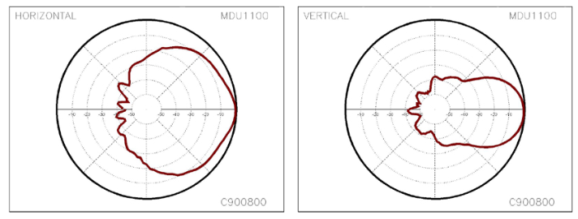
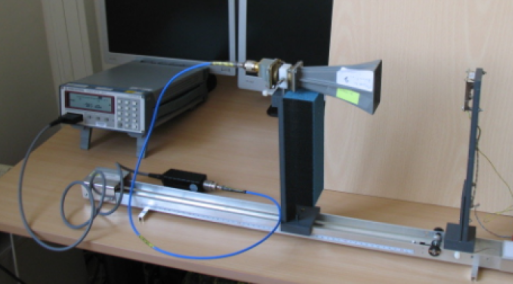
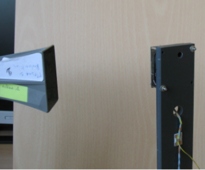
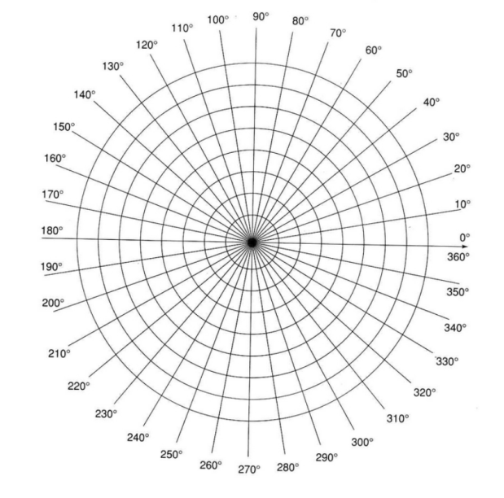
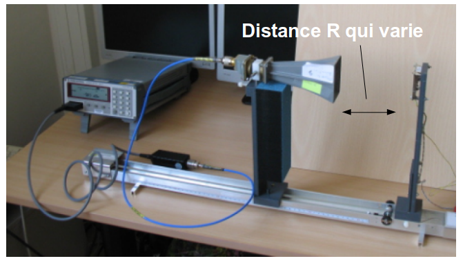

# TP Radar Doppler MDU1130 - Caractérisation des antennes

*Franck Daout*
*CFD Bourges*

*Dernière modification : 02 novembre 2026*

**Mots-clés**

* Antennes, Diagramme d'antenne, Atténuation de distance, Powermeter.

## Objectifs

* Caractériser le diagramme d'antenne de la tête radar MDU1130 :
    * en utilisant un powermeter (ou une sonde USB),
    * en utilisant une antenne cornet bande X.
* Identifier la loi d'atténuation de la distance (diminution de la puissance).

---

## Diagramme d'antenne

## Présentation de l'activité

L'antenne est le dispositif qui assure la transition entre la ligne de propagation et l'espace libre dans lequel les ondes vont se propager, et inversement. 

Le diagramme de rayonnement de l'antenne donne la répartition dans l'espace de l'énergie rayonnée ou reçue par l'antenne. Il peut donc être défini par le rapport :

$$
r(\theta)=\frac{P_{r}(\theta)}{\mathbf{max}(P_{r})}
$$

Ou $P_r$ est la puissance mesurée en sortie de l'antenne utilisée en réception et $\theta$ l'angle permettant de repérer l'orientation de l'antenne. Généralement l'angle $\theta$ = 0° correspond à $P_r(\theta = 0)= \mathbf{max}(P_{r})$.

Ce diagramme est le plus souvent exprimé en dBi :

$$
r_{dBi}(\theta)=10\log_{10}(r(\theta))
$$

Il y a plusieurs représentations graphiques possibles. Le diagramme de rayonnement peut être représenté en coordonnées polaires ou en coordonnées cartésiennes. Le diagramme d'antenne (figure ci-dessous) est généralement représenté dans deux plans orthogonaux liés à la structure de l'onde (onde TEM) :

* Plan E. 
* Plan H.

## Description de la manipulation

Le diagramme d'antenne du radar est réalisé en tournant le module radar. Pour chaque position, il suffit de relever la puissance reçue sur le powermeter. 

La distance entre l’antenne et le radar est déterminée à partir de l'expression du "champ lointain" :

$$
R\geq\frac{2D^{2}}{^{\lambda}}
$$

Avec $R$ la distance entre les deux antennes et $D$ la plus grande dimension des antennes (par exemple le diamètre du réflecteur dans le cas d’une parabole). 

### Application

1. Déterminer la distance $R$ minimum. 
2. Faire les mesures permettant de remplir le tableau suivant :

|$\theta$ (deg)| 0 | 20 | 40 | 60  | 80 | 100 | 120 | ...  | ...  |
|---|---|---|---|---|---|---|---|---|---|
|$P_r$ (dBm)   |   |   |   |   |   |   |   |   |   |

La figure ci-dessous représente la mesure du diagramme de l'antenne du radar à la position $\theta$ = 60°.

3. Tracer le diagramme d'antenne. 

4. Refaire la même manipulation en modifiant le plan de mesure. 
5. Comparer vos résultats aux spécifications du constructeur.

### Complément

La figure ci-dessous présente une autre démarche expérimentale qu'il est aussi possible d'adapter. 

."](figures/montage_JM.png)

---

## Mesure de l'atténuation distance 

### Présentation de l'activité

Nous allons évaluer la portée d’une liaison unidirectionnelle radiofréquence (opposée à une liaison bidirectionnelle RADAR). Ce calcul s’applique par exemple trivialement à une liaison wifi en remplaçant l’antenne “omnidirectionnelle” qui équipe un ordinateur portable par une antenne directive.

Le bilan de liaison radiofréquence traduit la distribution de la puissance reçue $P_r$ en fonction de la puissance émise $P_e$ :

$$
P_{r}=\frac{P_{e}G_{e}G_{r}\lambda^{2}}{(4\pi R)^{2}}
$$

Avec $R$ la distance entre les deux antennes, $G_e$ le gain de l'antenne d'émission, $G_r$ le gain du récepteur; $\lambda$ est la longueur d'onde et $R$ la distance entre l'émetteur et le récepteur. 

Généralement, l'équation ci-dessus est exprimée sous sa forme logarithmétique :

$$
P_r(dBm) = P_e(dBm) + G_e(dBi) + G_r(dBi) + 20\log_{10}(\lambda) - 20\log_{10}(4\pi) - 20\log_{10}(R)
$$

La puissance reçue par le récepteur $P_r$ dépend de la distance émetteur-récepteur $R$. La puissance reçue est inversement proportionnelle au carré de la distance parcourue, ce qui se traduit par :

$$
P_{r}=\frac{K}{R^{2}}
$$

À une distance de référence $R_0$, l'équation s'écrit :

$$
P_0 = \frac{K}{R_0^{2}}
$$

avec $P_0$ la puissance à la distance de référence.

soit : 

$$
P_{r}=P_{0}(\frac{R_{0}}{R})^{2}
$$

Cette équation exprimée en dB devient :

$$
P_r(dBm) = P_0(dBm) + 20\log_{10}(R_0) - 20\log_{10}(R)
$$

En représentant la variation de $P_r(dBm)$ en fonction de $20\log_{10}(R)$, une droite est observée. De plus, une multiplication par 2 de la distance entraîne une perte de 6 dB et une multiplication par 10 une atténuation de 20 dB.

### Description de la manipulation

L'atténuation distance du radar est réalisée en déplaçant le module radar (figure ci-dessous). Pour chaque distance, il suffit de relever la puissance reçue sur le powermeter.

#### Application

1. Réaliser les mesures permettant de remplir le tableau suivant.

| R (m)  |  0.2 |  0.3 |  0.4 | 0.5  | 0.6  | 0.8  |  1.0 | 1.2  |  1.4 |
|---|---|---|---|---|---|---|---|---|---|
|$P_r$ (dBm)   |   |   |   |   |   |   |   |   |   |

2. Représenter la caractéristique $P_r(dBm)$ en fonction de $20\log_{10}(R)$.
3. Conclure.

