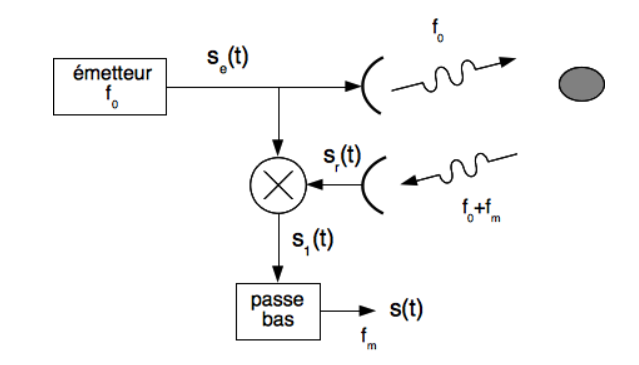
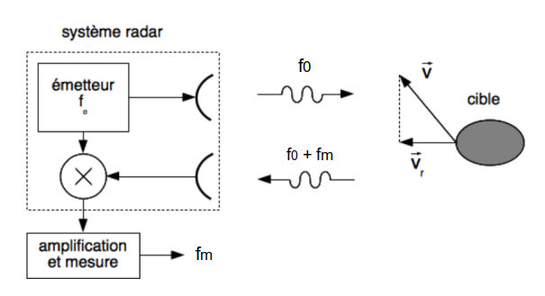
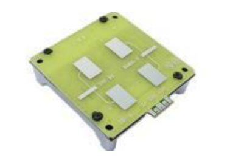
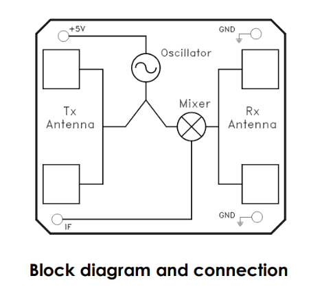
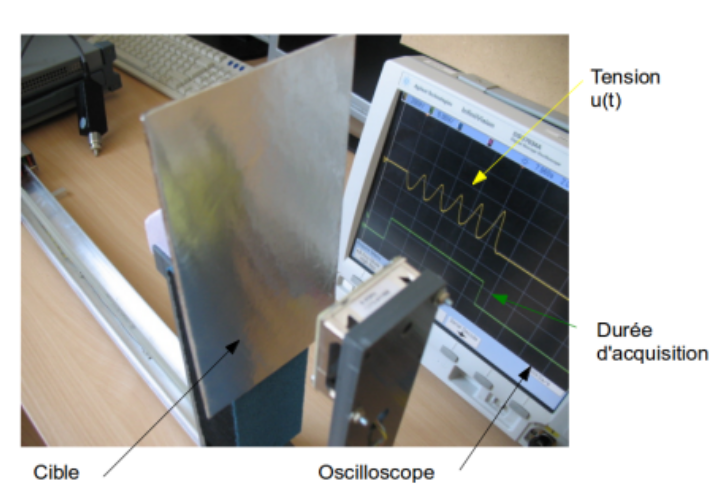
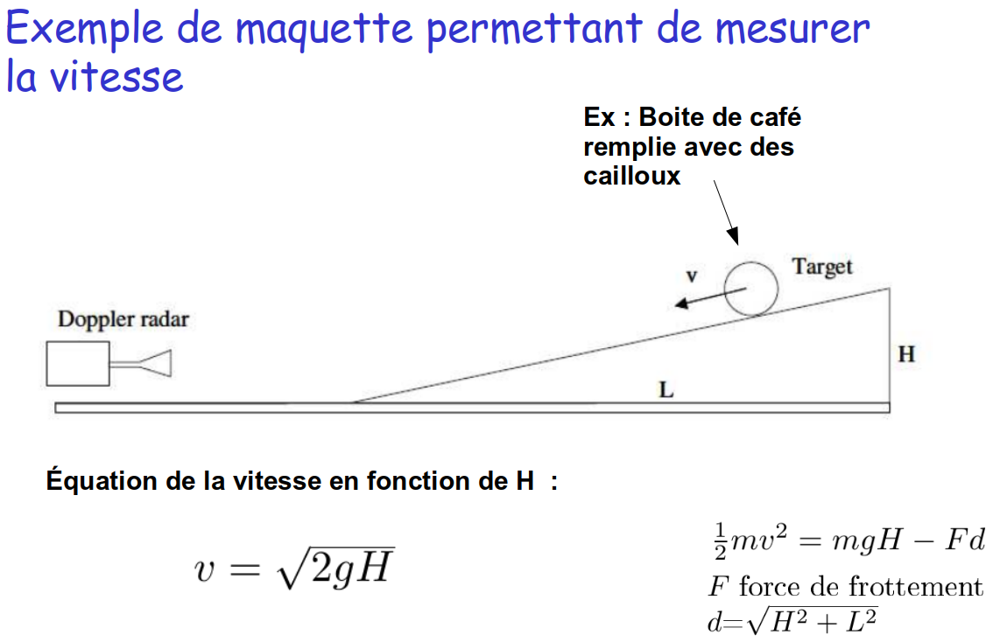
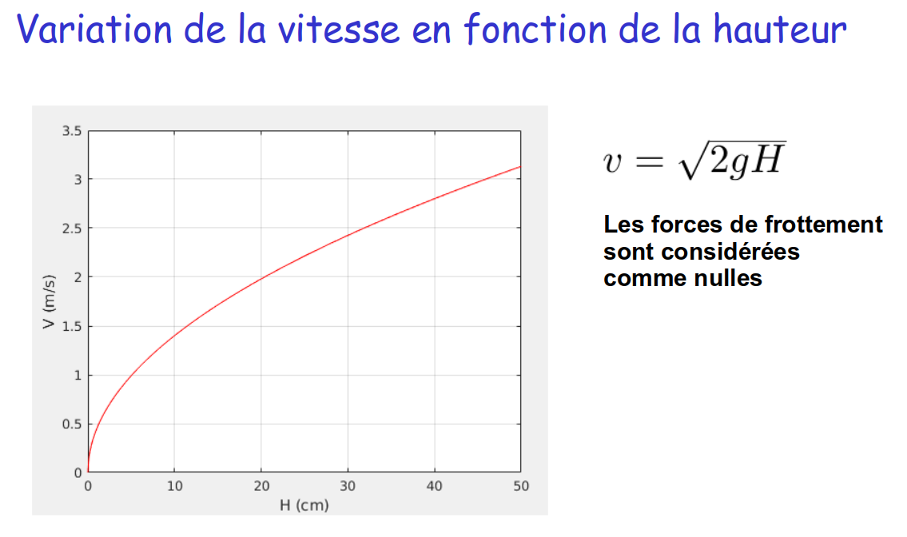
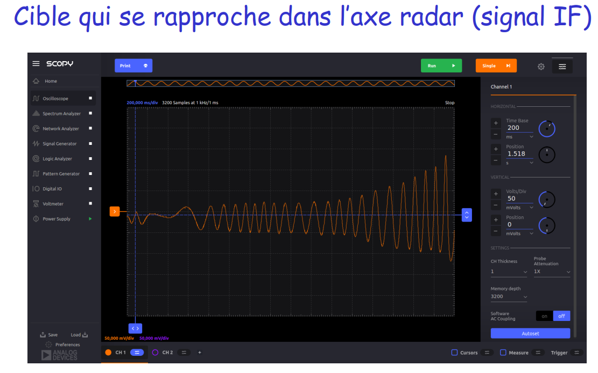

# TP Radar Doppler MDU1130 - Mise en œuvre

*Franck Daout*

*CFD Bourges*

*Derniére modification : 02 novembre 2026*

**Mots-clés**

* radar doppler, radar impulsionnel, tête radar MDU1130.

## Objectifs 

* Comprendre la différence entre un radar doppler et un radar impulsionnel.
* Comprendre le principe de fonctionnement d'un radar doppler.
* Mettre en œuvre un radar doppler : tête radar [MDU1130](documents/MDU1130.pdf)
    * Déterminer sa portée.
    * Mesurer la vitesse d'une cible.

---

## Principe de fonctionnement d'un radar doppler 

### Radar doppler

Le principe d'un radar est d'illuminer une cible à l'aide d'une onde électromagnétique. Celle-ci reflète une partie de l'énergie et est donc détectable par la partie réception du Radar. L'écho renvoyé par la cible est de même fréquence que le signal émis si la cible est immobile, mais de fréquence différente si celle-ci est en mouvement. Cette caractéristique constitue l'effet doppler.

La variation de la fréquence étant proportionnelle à la vitesse de l'objet, il est donc possible de mesurer cette vitesse à partir de la fréquence doppler.

Contrairement au radar impulsionnel qui permet de détecter une cible radar et de déterminer sa position, un radar doppler (appelé aussi radar à ondes continues - "radar CW" pour continuous wave) ne permet que de mesurer la vitesse d'une cible.

### Constitution 

Un système radar doppler (figure ci-dessus) est constitué d'un émetteur à la fréquence $f_0$. À la réception, l'onde réfléchie par la cible radar est démodulée à la fréquence $f_0$. Si une fréquence $f_m$ se superpose à la fréquence $f_0$, alors cette fréquence $f_m$ est détectée à la suite du filtre passe-bas. 

### Principe de la mesure de la vitesse radiale

Le principe est une simple mesure de l'écart entre les fréquences émise ($f_0$) et reçue ($f_0 + f_m$).

La valeur de la vitesse radiale $V_r$ s'exprime en fonction de la fréquence doppler $f_m$ et de la fréquence émise $f_0$ :

$$
f_{m}=\frac{2V_{r}}{\lambda}=\frac{2V_{r}f_{0}}{c}
$$

avec $c$ la vitesse de la lumière.

Ce type de système ne peut pas mesurer de distance. En effet, une distance ne peut être mesurée qu'avec un retard, ce qui est équivalent à un déphasage dans le cas d'une onde continue. Dans ce cas, l'ambiguïté de phase est donnée "modulo" $2\pi$.

Ainsi, il faudrait une fréquence d'émission très faible (de l'ordre du kHz) pour localiser des cibles à plusieurs centaines de mètres. La conséquence serait alors l'utilisation d'antennes de dimensions très importante.

### MDU1130 : Étude de la datasheet

La tête doppler MDU1130 est une tête radar doppler bande X. Sa datasheet est disponible via ce [lien](documents/MDU1130.pdf)

#### Application

1. À partir des descriptions constructeurs, déterminer :
    * La fréquence d’émission, en déduire la longueur d’onde.
    * Le gain des antennes.
    * La sensibilité du récepteur pour un RSB de 10 dB et pour un RSB de 0 dB.
    * La puissance émise.
2. En supposant que la cible se déplace entre 0.001 m/s et 10 m/s, déterminer la plage de fréquence doppler.
3. En supposant que la cible a une SER de 0 dBm2, déterminer la portée du système radar étudié.

---

## Mise en œuvre de la tête radar MDU1130 

Le module MDU1130 s'alimente à partir d'une tension continue de **5 V**. Le signal démodulé (signal Doppler) est disponible sur la sortie IF.

#### Attention

**Ne pas dépasser la tension d’alimentation → vérifier la valeur de votre alimentation.**

**Ne pas alimenter la broche IF.**

### Manipulation : Mesure de la vitesse d'une cible

 

Une cible est déplacée devant les antennes du module MDU1130. Dans cette partie, choisir la cible qui présente la plus grande surface. La nature de la cible modifie l'amplitude du champ réfléchie. Dans la mesure du possible, déplacer la cible dans l’axe du radar avec une vitesse constante. 

La mesure de la vitesse est réalisée en observant l'oscilloscope. 

1. Realiser différentes mesures de vitesse de cible.
2. Modifier la nature de la cible et mesurer son influence sur le signal reçu. Cela modifie-t-il la fréquence doppler ?

### Complément : un peu de physique

---

